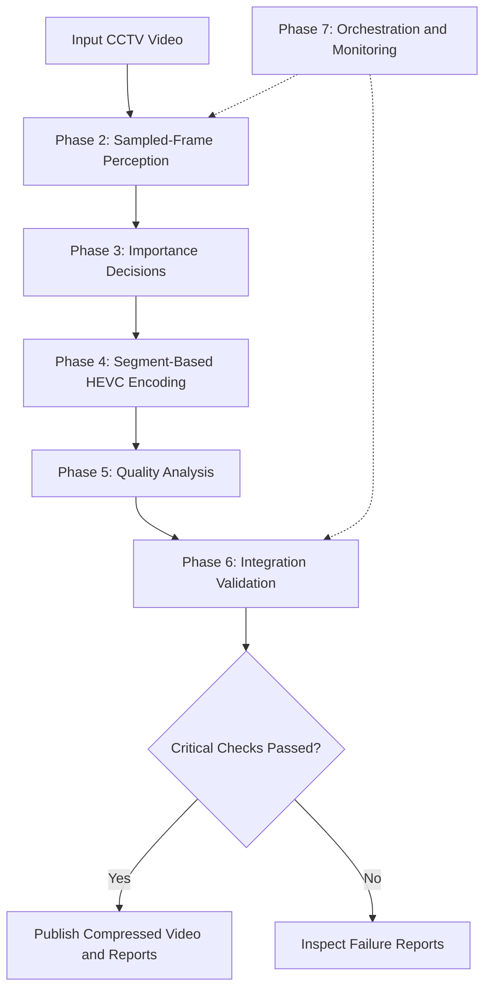

# SentinelCompress

<div align="center">

### AI-Powered CCTV Video Compression

**Store more surveillance footage without sacrificing the details that matter.**

A computer-vision-assisted video compression pipeline that combines object detection, frame-importance analysis, adaptive HEVC encoding, and automated quality validation to reduce CCTV storage requirements.

[](https://www.python.org/)
[](https://opencv.org/)
[](https://docs.ultralytics.com/)
[](https://ffmpeg.org/)
[](https://trac.ffmpeg.org/wiki/Encode/H.265)

[**Explore the repository**](https://github.com/MayurDas24/CCTV-Compression-Project) · [Report an issue](https://github.com/MayurDas24/CCTV-Compression-Project/issues)

</div>

---

## At a glance

<details>
<summary><strong>Project highlights</strong></summary>

- Computer-vision-assisted analysis of sampled video frames
- Frame-importance decisions that inform downstream compression
- Segment-based HEVC/H.265 encoding using FFmpeg
- PSNR, SSIM, and VMAF quality evaluation when timeline alignment is valid
- Cross-phase integration checks before final artifact publishing
- Configuration-driven orchestration, resource monitoring, and run reports

</details>

| Metric | Best demonstrated result |
|---|---:|
| Storage reduction | **70.03%** |
| Compression ratio | **3.34×** |
| Source resolution | 4K UHD — 3840 × 2160 |
| PSNR | 43.67 dB |
| SSIM | 0.984427 |
| VMAF | 96.712255 |
| Final integration checks | 45 passed |
| Demonstrated workflow | Local video, Phases 2–7 |

*Results are from a specific test video, not a guarantee of equivalent savings on every input.*

## The problem

CCTV systems continuously generate video, and the cost of retaining footage grows with the number of cameras, recording duration, and video quality.

Reducing bitrate or resolution can save storage, but it may also make footage less useful when someone needs to review an incident.

SentinelCompress explores a different approach: **use visual information to guide compression decisions, then validate the resulting video before publishing it.**

The project combines sampled-frame object detection, frame-importance decisions, segment-level encoding quality, and automated validation in a modular pipeline.

### What it aims to achieve

- Reduce the storage footprint of CCTV recordings.
- Preserve resolution, frame rate, duration, and frame count in validated test cases.
- Maintain good visual fidelity at a smaller file size.
- Detect inconsistencies instead of silently accepting a failed processing run.
- Make compression results measurable and reproducible.

> **Current scope:** This is an engineering prototype with demonstrated local-video processing. Production-scale CCTV deployment, long-running RTSP ingestion, and preservation of object-detection accuracy after compression have not been comprehensively validated.

---

## Results that matter

### Test 1 — 4K footage

<details open>
<summary><strong>Compression breakdown</strong></summary>

| Measurement | Original | Compressed |
|---|---:|---:|
| File size | 63.47 MB | 19.02 MB |
| Resolution | 3840 × 2160 | 3840 × 2160 |
| Frame count | 528 | 528 |
| Video codec | H.264 | HEVC/H.265 |

| Result | Value |
|---|---:|
| Storage saved | 44.45 MB |
| Storage reduction | **70.03%** |
| Compression ratio | 3.34× |
| PSNR | 43.67 dB |
| SSIM | 0.984427 |
| VMAF | 96.712255 |
| Phase 6 integration | 45 checks passed |

The output was played back and visually inspected. The reported metrics and playback were encouraging for this particular input.

</details>

### Test 4 — another 4K clip

| Measurement | Result |
|---|---:|
| Original size | 37.00 MB |
| Compressed size | 21.97 MB |
| Storage saved | 15.04 MB |
| Storage reduction | **40.64%** |
| Compression ratio | 1.68× |
| PSNR | 45.81 dB |
| SSIM | 0.989684 |
| VMAF | 97.285181 |
| Duration | 12.145467 s, preserved |
| Frame count | 364 → 364 |
| Critical validation checks | 45 passed |

Test 4 demonstrates that savings vary across inputs. Both reported successful tests preserved the original resolution, frame count, and duration.

### A note on quality metrics

- **PSNR:** measures pixel-level signal fidelity; higher is generally better when comparing equivalent evaluation setups.
- **SSIM:** measures structural similarity; values closer to 1 generally indicate greater similarity.
- **VMAF:** estimates perceptual video quality; higher scores generally indicate better predicted quality.

These metrics assess video fidelity. They do not, on their own, prove that object detection or downstream surveillance analytics perform identically after compression.

---

## System architecture



### The processing pipeline

| Phase | Responsibility |
|---|---|
| **Phase 0** | Baseline and adaptive-compression experiments |
| **Phase 1** | Real-time encoding and RTSP-ingestion experiments |
| **Phase 2** | Frame sampling and YOLOv8n object detection |
| **Phase 3** | Frame-importance and retention decisions |
| **Phase 4** | Segment-based HEVC/H.265 encoding |
| **Phase 5** | Video validation and objective quality metrics |
| **Phase 6** | Cross-phase consistency checks and final artifact publishing |
| **Phase 7** | Job orchestration, scheduling, resource monitoring, and reporting |

Phases 0 and 1 are experimental or streaming-oriented. The demonstrated finite local-video workflow runs through Phases 2–6, with Phase 7 coordinating execution.

### How the phases work together

<details>
<summary><strong>Phase 2 — Perception</strong></summary>

Samples frames from the source video and runs YOLOv8n object detection on selected frames. Detection metadata is written for downstream processing.

Detection runs on sampled frames rather than every frame, reducing inference work but leaving some moments unobserved by the detector.

</details>

<details>
<summary><strong>Phase 3 — Importance decisions</strong></summary>

Uses perception output and temporal analysis to produce frame-importance and retention decisions. These decisions inform the subsequent compression workflow.

A retention decision does not necessarily mean a frame is physically removed from the final video.

</details>

<details>
<summary><strong>Phase 4 — Adaptive encoding</strong></summary>

Uses FFmpeg to encode video segments with selected HEVC/H.265 quality settings. The demonstrated strategy primarily changes segment-level encoding quality while preserving the timeline.

</details>

<details>
<summary><strong>Phase 5 — Quality analysis</strong></summary>

Checks video properties, file sizes, and consistency. It computes PSNR, SSIM, and VMAF when valid source/output timeline alignment can be established.

</details>

<details>
<summary><strong>Phase 6 — Integration and publishing</strong></summary>

Consolidates results from upstream phases and checks cross-phase consistency. Final artifacts are published when the required critical integration checks pass.

A failed check should be investigated rather than bypassed.

</details>

<details>
<summary><strong>Phase 7 — Orchestration</strong></summary>

Coordinates local-video jobs through a configuration-driven adapter. It includes scheduling, resource monitoring, health monitoring, configuration validation, and run reporting.

The tested configuration processes one camera at a time. Orchestration success alone does not guarantee that compression succeeded; the camera-level result and final validation report must also be checked.

</details>

---

## Technology stack

| Technology | Purpose |
|---|---|
| Python 3.11 | Pipeline implementation |
| OpenCV | Video and frame processing |
| Ultralytics YOLOv8n | Object detection on sampled frames |
| FFmpeg / FFprobe | Video encoding and metadata inspection |
| HEVC/H.265 | Compressed output codec |
| YAML / PyYAML | Configuration management |
| Pytest | Automated tests |

---

# Getting started

The following instructions describe the repository's documented Windows PowerShell workflow.

## 1. Prerequisites

Install the following:

- Python 3.11
- Git
- FFmpeg and FFprobe, available on your system `PATH`

Verify the tools:

```powershell
python --version
git --version
ffmpeg -version
ffprobe -version
```

If FFmpeg or FFprobe is not recognized, install FFmpeg and add its `bin` directory to `PATH`, then open a new terminal.

## 2. Clone the repository

```powershell
git clone https://github.com/MayurDas24/CCTV-Compression-Project.git
cd CCTV-Compression-Project
```

## 3. Create a virtual environment

```powershell
python -m venv .venv
.\.venv\Scripts\Activate.ps1
```

If PowerShell blocks environment activation, review your execution policy or use the activation script from Command Prompt.

## 4. Install Python dependencies

The repository uses phase-specific `requirements.txt` files rather than a confirmed, unified root dependency file.

List the available files:

```powershell
Get-ChildItem -Path . -Filter requirements.txt -Recurse |
    Where-Object { $_.FullName -notmatch '\\(\.venv|venv)\\' }
```

Install the requirements needed for the phases you intend to run, following the relevant phase-specific instructions.

For the complete local-video workflow, dependencies from Phases 2–7 may be required. Phase 7 launches the upstream processing pipeline through an adapter, so installing only the orchestration dependencies may not be sufficient.

The model weights required by the perception phase must also be available locally or obtainable through the configured model-loading process.

## 5. Validate the configuration

```powershell
python -m phase_7.phase7_pipeline --validate-config
```

The default configuration uses **probe-only mode**. This checks the configured sources but does not run the compression pipeline.

---

# Compress your own video

This is the section most developers should need after installation.

## Option A — Use the Phase 7 orchestrator

### Step 1. Place your video in the project

For example, create a directory for your own footage:

```powershell
New-Item -ItemType Directory -Force .\my_videos
```

Copy your video into this directory using File Explorer. Suppose it is named `office_cctv.mp4`.

Your input path will be:

```text
.\my_videos\office_cctv.mp4
```

You can use another path if you prefer.

### Step 2. Configure a camera source

Open:

```text
phase_7/config.yaml
```

Under `sources`, add a new entry or update an existing one. For example:

```yaml
- camera_id: "office_test"
  enabled: true
  source_type: "local_file"
  source: "../my_videos/office_cctv.mp4"
  required: true
  display_name: "Office CCTV test"
  tags:
    - "local"
```

**Important:** Paths in the Phase 7 configuration are resolved relative to the `phase_7` directory. That is why the example uses `../my_videos/office_cctv.mp4`.

Make sure the camera ID is unique, save the file, and validate the configuration:

```powershell
python -m phase_7.phase7_pipeline --validate-config
```

### Step 3. Run actual compression

```powershell
python -m phase_7.phase7_pipeline --run-pipeline --camera-id office_test
```

The `--run-pipeline` flag explicitly enables the configured local-file Phase 2–6 adapter.

Without this flag, the default configuration can remain in probe-only mode. A probe-only run does not compress the video.

Let the process finish naturally. High-resolution video can take several minutes and may require substantial memory.

### Step 4. Find the output

Phase 7 creates a new run directory under:

```text
phase_7/outputs/
```

The final output is normally found at:

```text
phase_7/outputs/<run-id>/cameras/office_test/final/compressed_video.mp4
```

Replace `<run-id>` with the directory created by your run.

The final folder can also contain:

- `phase_6_final_report.json`
- `phase_6_final_report.txt`
- `phase_6_artifact_manifest.json`

The camera directory can contain `pipeline_adapter_result.json`, logs, and intermediate phase outputs.

### Step 5. Confirm that compression succeeded

Do not rely only on a terminal message saying that Phase 7 completed.

Verify that:

1. `final/compressed_video.mp4` exists and is non-empty.
2. The adapter result confirms compression success.
3. The Phase 6 report says the critical validation checks passed.
4. The video opens and plays.
5. The reported source/output metrics are consistent with the result.

---

## Option B — Run the processing adapter directly

The repository also includes `phase_7/pipeline_adapter.py` for invoking the Phase 2–6 local-video pipeline without the Phase 7 scheduler.

First, inspect its supported command-line arguments:

```powershell
python .\phase_7\pipeline_adapter.py --help
```

The documented argument pattern is:

```powershell
python .\phase_7\pipeline_adapter.py `
    --project-root "." `
    --source ".\my_videos\office_cctv.mp4" `
    --camera-id "office_test" `
    --camera-output-dir ".\phase_7\outputs\office_test"
```

This command illustrates the adapter's input and output arguments. If your checkout requires additional arguments, follow the options shown by `--help`.

The expected final output path for this direct-run example is:

```text
phase_7/outputs/office_test/final/compressed_video.mp4
```

Use Option A if you want the orchestrator's scheduling, resource monitoring, and run-level reports.

---

## Understanding compression results

The pipeline reports source and output sizes, storage reduction, and compression ratio.

### Storage reduction

\[
\text{Reduction (\%)} =
\frac{\text{Original Size}-\text{Compressed Size}}
{\text{Original Size}}\times100
\]

### Compression ratio

\[
\text{Ratio} =
\frac{\text{Original Size}}{\text{Compressed Size}}
\]

For example, a 100 MB video compressed to 40 MB gives a 60% storage reduction and a 2.5× compression ratio.

Actual results depend on the source footage, encoding configuration, and scene complexity.

---

## Testing

The latest recorded automated test run for the Phase 4–7 suites completed with **18 tests passing**.

Run the tests from the repository root with the virtual environment activated:

```powershell
python -m pytest .\phase_4\tests .\phase_5\tests .\phase_6\tests .\phase_7\tests -v
```

Install the relevant test dependencies if necessary.

The automated tests cover selected encoding, quality-validation, integration, configuration, and orchestration behaviors. Passing tests do not guarantee that every input video will pass the full end-to-end workflow.

---

## Troubleshooting

<details>
<summary><strong>1. The command says the module cannot be found</strong></summary>

Use the actual Phase 7 entry point:

```powershell
python -m phase_7.phase7_pipeline --help
```

This repository does not use `phase_7.run`.

</details>

<details>
<summary><strong>2. Phase 7 finishes, but no compressed video appears</strong></summary>

Check the run report, camera report, `pipeline_adapter_result.json`, and Phase 6 final report.

Possible causes include probe-only mode, resource-admission failure, a missing dependency, an encoding error, or failed integration validation.

</details>

<details>
<summary><strong>3. Memory admission fails</strong></summary>

Close unnecessary memory-intensive applications and retry with a shorter clip if needed. High-resolution footage can require substantial resources.

Do not weaken resource or integration checks merely to force a run to proceed.

</details>

<details>
<summary><strong>4. Frame-count validation fails</strong></summary>

Compare the source and output metadata, then inspect the Phase 4, Phase 5, and Phase 6 reports. Treat the mismatch as a defect to investigate instead of bypassing the validation.

</details>

<details>
<summary><strong>5. FFmpeg or FFprobe is not recognized</strong></summary>

Run:

```powershell
ffmpeg -version
ffprobe -version
```

Install FFmpeg and add its `bin` directory to `PATH` if necessary, then open a new terminal.

</details>

<details>
<summary><strong>6. A Python dependency or model is missing</strong></summary>

Confirm that the virtual environment is active. Install the requirements for the phase reporting the error and ensure that the required YOLO model weights are available.

</details>

---

## Known limitations

The project has demonstrated local-video compression and validation, but several areas need further evaluation.

- **Input-dependent savings:** storage reduction varies across footage and encoding settings.
- **Frame-count consistency:** Test 3 produced an intermediate compressed video but failed final integration because the reported frame counts did not agree.
- **Detection preservation:** object-detection accuracy on compressed footage has not been comprehensively benchmarked against the original.
- **RTSP streaming:** real-camera ingestion and reconnection behavior have not been comprehensively validated.
- **Long-duration processing:** production-scale continuous processing has not been established.
- **Multi-camera throughput:** the tested configuration processes one camera at a time.
- **Hardware performance:** edge-device and dedicated hardware performance have not been validated.
- **Platform support:** the documented workflow is Windows PowerShell.

---

## Roadmap

- [ ] Establish a unified and reproducible installation procedure.
- [ ] Resolve and regression-test the Test 3 frame-count mismatch.
- [ ] Expand end-to-end tests across different types of CCTV footage.
- [ ] Benchmark object detection before and after compression.
- [ ] Evaluate low-light and high-motion footage.
- [ ] Validate long-running RTSP ingestion and reconnection.
- [ ] Evaluate multiple cameras under realistic resource constraints.
- [ ] Improve processing throughput and memory efficiency.

---

## Repository structure

```text
CCTV-Compression-Project/
├── phase_0/       # Baseline and adaptive compression experiments
├── phase_1/       # Real-time encoding and RTSP experiments
├── phase_2/       # Frame sampling and object detection
├── phase_3/       # Importance and retention decisions
├── phase_4/       # HEVC/H.265 encoding
├── phase_5/       # Quality analysis and validation
├── phase_6/       # Integration checks and final artifacts
├── phase_7/       # Orchestration and resource monitoring
├── live_test/     # Live-testing utilities
├── README.md
└── .gitignore
```

Individual phases may contain additional modules, configuration files, requirements, tests, and intermediate artifacts.

---

## Author

**Mayur R Das**

- GitHub: [@MayurDas24](https://github.com/MayurDas24)
- Repository: [CCTV-Compression-Project](https://github.com/MayurDas24/CCTV-Compression-Project)

## License

Check the repository for a `LICENSE` file. If none exists, no open-source license should be assumed. Add an appropriate license before inviting others to reuse or redistribute the code.

---

<div align="center">

**Built to explore the intersection of computer vision, video compression, and reliable media pipelines.**

</div>
