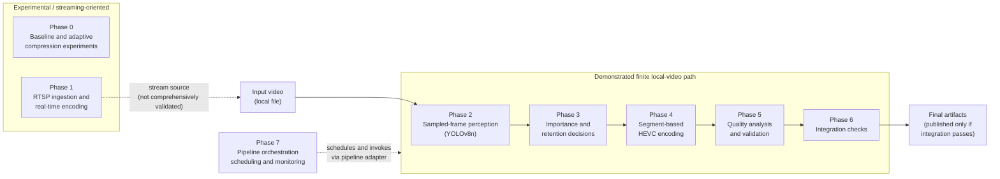

<div align="center">

# AI-Powered CCTV Video Compression System

*Computer-vision-assisted video compression for storage-efficient CCTV footage with quality-aware encoding and pipeline validation.*

[](https://www.python.org/)
[](https://opencv.org/)
[](https://docs.ultralytics.com/)
[](https://ffmpeg.org/)
[](https://trac.ffmpeg.org/wiki/Encode/H.265)
[](https://github.com/MayurDas24/CCTV-Compression-Project)

</div>

---

## At a Glance

A modular Python pipeline that **samples video frames, detects objects with YOLOv8n, derives frame-importance decisions, applies segment-based HEVC encoding through FFmpeg, and validates the result** with objective quality metrics and cross-phase integration checks before publishing final artifacts.

| | |
|---|---|
| **Best result so far** | 4K test clip: **70.03% storage reduction** (3.34×), PSNR 43.67 dB, SSIM 0.984427, VMAF 96.712255, all 528 frames preserved |
| **Design principle** | Preserve the video timeline; compress by segment-level quality settings rather than physically removing frames |
| **Quality gate** | Final artifacts are published only when critical integration checks pass |
| **Status** | Finite local-video workflow demonstrated (Phases 2–7). Streaming and long-duration behavior not yet comprehensively validated |

> [!NOTE]
> Results below come from specific experiments on specific footage. They are not claims of production-scale savings across all CCTV workloads.

---

## Table of Contents

1. [Overview](#overview)
2. [Key Capabilities](#key-capabilities)
3. [Architecture](#architecture)
4. [Phase-by-Phase Implementation](#phase-by-phase-implementation)
5. [Technology Stack](#technology-stack)
6. [Experimental Results](#experimental-results)
7. [Getting Started](#getting-started)
8. [Running the Pipeline](#running-the-pipeline)
9. [Understanding Generated Artifacts](#understanding-generated-artifacts)
10. [Testing and Validation](#testing-and-validation)
11. [Limitations and Known Issues](#limitations-and-known-issues)
12. [Roadmap](#roadmap)
13. [Repository Structure](#repository-structure)
14. [Troubleshooting](#troubleshooting)
15. [Author](#author)
16. [License](#license)

---

## Overview

CCTV systems record continuously, so storage requirements and costs grow quickly. Conventional video encoding treats footage largely by signal statistics and does not necessarily account for the *semantic importance* of what is in the frame.

This project explores a computer-vision-assisted alternative. It analyzes sampled frames, records object detections, converts them into frame-importance and retention decisions, and feeds those into a segment-based encoding strategy. The output is then checked for consistency and measured for visual quality.

**Goal:** reduce storage consumption while retaining good visual quality and preserving the video's temporal structure.

**What this project is not (yet):** a validated, production-scale CCTV storage solution. See [Limitations and Known Issues](#limitations-and-known-issues).

---

## Key Capabilities

- **Sampled-frame perception**: object detection with YOLOv8n on a subset of frames, with detection metadata written for downstream stages.
- **Importance and retention decisions**: frame-level decisions produced from detections and temporal analysis.
- **Segment-based HEVC/H.265 encoding**: different quality settings across segments via FFmpeg, preserving resolution, FPS, duration, and frame count.
- **Compression metrics**: source and output size, reduction percentage, and compression ratio.
- **Objective quality analysis**: PSNR, SSIM, and VMAF when valid source/output timeline alignment can be established.
- **Integration validation as a quality gate**: cross-phase consistency checks must pass before final artifacts are published.
- **Pipeline orchestration**: Phase 7 coordinates the local-video workflow, with configuration validation, a smoke test, and resource and health monitoring components.

---

## Architecture

The repository contains `phase_0` through `phase_7`. Phases 0 and 1 are experimental and streaming-oriented components. The demonstrated finite local-video path runs through Phases 2–6, and Phase 7 *orchestrates* that path rather than acting as another video-transformation stage.



---

## Phase-by-Phase Implementation

| Phase | Role | Status |
|:--:|---|---|
| [0](phase_0/) | Baseline and adaptive compression experiments | Experimental foundation |
| [1](phase_1/) | RTSP ingestion and real-time encoding | Streaming-oriented; needs broader validation |
| [2](phase_2/) | Frame sampling and YOLOv8n detection | Demonstrated |
| [3](phase_3/) | Frame importance and compression decisions | Demonstrated |
| [4](phase_4/) | Segment-based HEVC compression | Demonstrated |
| [5](phase_5/) | Quality analysis and validation | Demonstrated |
| [6](phase_6/) | Integration checks and artifact publishing | Demonstrated |
| [7](phase_7/) | Orchestration, scheduling, monitoring | Demonstrated for finite local video |

<details>
<summary><strong>Phase 0: Baseline and Adaptive Compression Experiments</strong></summary>

<br>

The experimental foundation for comparing baseline and adaptive compression approaches.

- Components: `adaptive_compression.py`, `baseline_encoder.py`, `evaluation.py`, `config.yaml`, `requirements.txt`, `results.csv`, and a results directory holding experimental output videos.
- This README does not report numerical results for Phase 0.

</details>

<details>
<summary><strong>Phase 1: Real-Time Encoding and RTSP Ingestion</strong></summary>

<br>

Explores video ingestion and real-time or streaming-oriented encoding.

- Components: `realtime_encoder.py`, `rtsp_ingestion.py`, `config.yaml`, `requirements.txt`.
- **Limitation:** the presence of these modules does not establish that continuous production CCTV streaming, reconnection behavior, or long-duration stream reliability have been comprehensively validated.

</details>

<details>
<summary><strong>Phase 2: Perception and Object Detection</strong></summary>

<br>

Samples frames from the source video and runs YOLOv8n inference on them, writing detection metadata for downstream phases.

- Components: `perception.py`, `detector.py`, `frame_sampler.py`, `metadata_writer.py`, `config.yaml`.
- **Sampled-frame inference vs. every-frame inference:** detection runs only on sampled frames, not on every source frame. This reduces compute cost but means detections are a sparse view of the timeline.

Test 1 observations (one experiment, not universal model performance):

| Measurement | Value |
|---|---:|
| Source resolution | 3840 × 2160 |
| Source FPS | ≈ 29.97 |
| Source frame count | 528 |
| Sampled frames | 36 (≈ 6.8% of source frames) |
| Total detections recorded | 176 |
| Average detection confidence | 0.4875 |
| Sampled processing throughput | ≈ 2.37 sampled frames/s |

</details>

<details>
<summary><strong>Phase 3: Frame Importance and Compression Decisions</strong></summary>

<br>

Consumes perception output and produces frame-level importance or retention decisions.

- Components: `phase3_pipeline.py`, `compression_policy.py`, `decision_writer.py`, `importance_engine.py`, `temporal_analyzer.py`.
- Test 1: 36 frame-decision records, 35 retained, 1 dropped.

> [!IMPORTANT]
> A "dropped" decision does **not** mean Phase 4 physically removes that frame. The demonstrated compression mechanism is segment-based quality encoding that preserves the timeline, not frame removal.

</details>

<details>
<summary><strong>Phase 4: Segment-Based Video Compression</strong></summary>

<br>

Generates the compressed video using segment-based quality encoding with HEVC/H.265 via FFmpeg, applying different quality settings across selected segments while preserving the timeline.

- Components: `phase4_pipeline.py`, `compression_metrics.py`, `frame_selector.py`, `video_encoder.py`.
- Inspects video properties and frame counts, performs segment encoding and final output generation, and reports source/output sizes, reduction percentage, and compression ratio.

</details>

<details>
<summary><strong>Phase 5: Quality Analysis and Validation</strong></summary>

<br>

Checks video properties, compression results, and output consistency, and computes objective quality metrics when valid source/output timeline alignment can be established.

- Components: `phase5_pipeline.py`, `metrics.py`, `quality_analysis.py`, `reporting.py`, `validation.py`.
- If alignment cannot be established (as in Test 3), objective metrics are not computed.

</details>

<details>
<summary><strong>Phase 6: Integration and Artifact Publishing</strong></summary>

<br>

Consolidates outputs from earlier stages, checks cross-phase consistency, and publishes final artifacts **only when critical integration validation succeeds**.

- Components: `phase6_pipeline.py`, `integration.py`, `final_report.py`, `artifact_manager.py`, `benchmark.py`, `reporting.py`.
- Integration validation is a deliberate quality gate. A failed check should be investigated, not bypassed or weakened.

</details>

<details>
<summary><strong>Phase 7: Pipeline Orchestration</strong></summary>

<br>

Manages processing jobs and coordinates execution of the downstream pipeline.

- Components: `phase7_pipeline.py`, `pipeline_adapter.py`, `stream_manager.py`, `camera_manager.py`, `processing_scheduler.py`, `resource_monitor.py`, `health_monitor.py`, `config.yaml`, `tests/test_phase7.py`.
- Supports finite local-video processing through a pipeline adapter that invokes Phases 2–6.
- Tested configuration uses sequential processing with a maximum concurrency of one.
- Includes configuration validation and smoke-test commands, plus resource and health monitoring components.
- Not validated across all camera, stream, concurrency, or deployment scenarios.

</details>

---

## Technology Stack

| Technology | Used for |
|---|---|
| **Python** | Pipeline implementation (Phase 7 tests were run on Windows with Python 3.11.9) |
| **OpenCV** | Video and frame handling |
| **Ultralytics YOLOv8 (YOLOv8n)** | Object detection on sampled frames |
| **FFmpeg / FFprobe** | HEVC/H.265 encoding and video metadata inspection |
| **YAML (PyYAML)** | Per-phase configuration files |
| **Pytest** | Automated tests, where applicable (e.g., Phase 7) |

---

## Experimental Results

All percentages and ratios are recalculated from exact byte counts. Megabyte values are decimal (1 MB = 1,000,000 bytes). Savings depend on the input footage and encoding configuration.

### Test 1: local 4K clip, full end-to-end success

| Measurement | Result |
|---|---:|
| Source size | 63,469,839 bytes (63.47 MB) |
| Compressed size | 19,018,829 bytes (19.02 MB) |
| Space saved | 44,451,010 bytes (≈ 44.45 MB) |
| Storage reduction | **70.03%** |
| Compression ratio | **3.34×** |
| PSNR | 43.67 dB |
| SSIM | 0.984427 |
| VMAF | 96.712255 |
| Frame count | 528 source / 528 output (preserved) |
| Resolution, FPS, duration | Reported as preserved |
| Phase 6 integration | 45 checks passed, 0 warnings, 0 errors |
| Pipeline result | Completed successfully |

The output was played back and visually inspected. The objective metrics and playback were encouraging for this input.

<details>
<summary><strong>How to read PSNR, SSIM, and VMAF</strong></summary>

<br>

- **PSNR** is a signal-fidelity measure in decibels. Higher values generally indicate smaller pixel-level error under comparable conditions.
- **SSIM** is a structural-similarity metric. Values closer to 1 generally indicate greater structural similarity.
- **VMAF** is a perceptual video-quality metric. Higher scores generally indicate better predicted perceptual quality under the metric's evaluation setup.

These metrics describe visual fidelity. They do **not** prove that downstream object-detection accuracy is preserved after compression. That has not been comprehensively benchmarked against the original video.

</details>

### Test 3: intermediate result only, final integration failed

| Measurement | Result |
|---|---:|
| Source size | 157,019,097 bytes (157.02 MB) |
| Phase 4 output size | 109,166,613 bytes (109.17 MB) |
| Space saved | 47,852,484 bytes (≈ 47.85 MB) |
| Storage reduction | 30.48% |
| Compression ratio | 1.44× |
| Final Phase 6 integration | **Failed** |

> [!WARNING]
> These are **intermediate Phase 4 measurements**, not a successful end-to-end run. Phase 5 saw source container metadata indicating 3640 frames versus 3632 frames in the compressed output, so it could not establish the timeline alignment required for objective quality metrics. One Phase 6 integration run reported 42 checks passed, 0 warnings, and 3 errors, all concerning frame-count consistency across the source, Phase 4, and Phase 5. That run did not publish final artifacts. This case is under investigation.

<details>
<summary><strong>Additional Test 3 details</strong></summary>

<br>

- Phase 4 output duration was approximately 145.359622 s versus approximately 145.3728 s for the source.
- The mismatch is a frame-count consistency issue surfaced by the Phase 5 and Phase 6 validation layers, which are working as intended by rejecting the run.

</details>

### Webcam experiment: 30 s recording processed through the adapter

| Measurement | Result |
|---|---:|
| Source duration | 30 seconds |
| Resolution / FPS | 640 × 480 at 20 FPS |
| Source size | 4,176,320 bytes |
| Compressed size | 1,323,909 bytes |
| Space saved | 2,852,411 bytes |
| Storage reduction | ≈ 68.30% |
| Compression ratio | ≈ 3.15× |
| Output codec | HEVC |
| Playback inspection | Good visual quality observed |

### Test 2

Test 2 was reported as working. Exact size, ratio, quality metrics, and integration report figures are not included here until they are available.

---

## Getting Started

### Prerequisites

- **Windows** with PowerShell (the primary tested workflow; other platforms are not claimed as supported)
- **Python 3.11** (Phase 7 tests passed on Python 3.11.9)
- **FFmpeg and FFprobe** available on your `PATH`
- Git

### Installation

**1. Clone the repository**

```powershell
git clone https://github.com/MayurDas24/CCTV-Compression-Project.git
cd CCTV-Compression-Project
```

**2. Create and activate a virtual environment**

```powershell
python -m venv .venv
.\.venv\Scripts\Activate.ps1
```

**3. Verify FFmpeg and FFprobe**

```powershell
ffmpeg -version
ffprobe -version
```

**4. Install Python dependencies**

The project has **phase-specific** `requirements.txt` files, and a single root requirements file has not been confirmed. List what exists, then install from the files for the phases you intend to run:

```powershell
Get-ChildItem -Path . -Filter requirements.txt -Recurse | Where-Object { $_.FullName -notmatch '\\\.venv\\' }
```

```powershell
# Example: install from one phase-specific file (repeat for other phases that ship one)
pip install -r .\phase_0\requirements.txt
```

If an import error appears at runtime, see [Troubleshooting](#troubleshooting).

---

## Running the Pipeline

### 1. Validate configuration and run the smoke test

```powershell
python .\phase_7\phase7_pipeline.py --validate-config
python .\phase_7\phase7_pipeline.py --smoke-test
```

### 2. Process a local video

You must supply your own input video at the path you pass to `--source`. The sample dataset may not be included in the public repository.

```powershell
python .\phase_7\pipeline_adapter.py `
  --project-root "." `
  --source ".\sample_videos\test1.mp4" `
  --camera-id "test1_run" `
  --camera-output-dir ".\phase_7\outputs\test1_run"
```

The adapter invokes Phases 2–6 for this finite local-video workflow.

---

## Understanding Generated Artifacts

For the documented `test1_run` example, the expected outputs were:

| Artifact | Path |
|---|---|
| Final compressed video | `phase_7/outputs/test1_run/final/compressed_video.mp4` |
| Run report | `phase_7/outputs/test1_run/pipeline_adapter_result.json` |

These are the expected paths from the documented test run, not guarantees for every configuration.

> [!IMPORTANT]
> Final artifacts are published only when Phase 6's critical integration validation succeeds. If integration fails, expect **no final compressed video** for that run. Inspect the per-phase reports instead.

---

## Testing and Validation

The Phase 7 test history (Windows, Python 3.11.9):

| Check | Result |
|---|---|
| Phase 7 automated tests | All 10 passed |
| Configuration validation | Passed |
| Smoke test | Passed |
| Local Test 1 end-to-end run | Completed successfully |
| 30-second webcam recording via adapter | Processed successfully |

To run the Phase 7 tests (adjust the path if `tests/` sits elsewhere in your checkout; install `pytest` first if it is not already present):

```powershell
pip install pytest
python -m pytest .\phase_7\tests\test_phase7.py
```

Beyond unit tests, the pipeline validates itself at runtime: Phase 5 checks properties and quality, and Phase 6 runs cross-phase integration checks before publishing.

---

## Limitations and Known Issues

- **Test 3** has an unresolved frame-count consistency problem at final integration.
- **RTSP streaming and reconnection** behavior has not been comprehensively validated.
- **Long-duration, multi-camera** production behavior has not been comprehensively tested.
- **Detection accuracy after compression** has not been benchmarked against the original video.
- **Objective quality metrics** require valid source/output timeline alignment.
- **Compression savings vary** with content, source codec, resolution, bitrate, and encoding settings.
- Tested configuration uses **sequential processing with concurrency of one**.
- Windows PowerShell is the documented workflow; other platforms are not claimed as supported.

---

## Roadmap

*Future work, not completed functionality.*

- [ ] Resolve and regression-test the Test 3 frame-count consistency issue
- [ ] Add broader automated end-to-end regression tests
- [ ] Benchmark object-detection performance before and after compression
- [ ] Evaluate long-duration RTSP ingestion and reconnection scenarios
- [ ] Test multiple cameras under realistic resource constraints
- [ ] Improve processing throughput and memory management
- [ ] Document reproducible codec and quality-setting comparisons
- [ ] Consider a unified dependency file and a streamlined setup procedure

---

## Repository Structure

A simplified overview. Some folders contain additional files, tests, requirements, and configuration.

```text
CCTV-Compression-Project/
├── phase_0/
│   ├── adaptive_compression.py
│   ├── baseline_encoder.py
│   ├── evaluation.py
│   └── config.yaml
├── phase_1/
│   ├── realtime_encoder.py
│   ├── rtsp_ingestion.py
│   └── config.yaml
├── phase_2/
│   ├── perception.py
│   ├── detector.py
│   ├── frame_sampler.py
│   └── metadata_writer.py
├── phase_3/
│   ├── phase3_pipeline.py
│   ├── compression_policy.py
│   ├── importance_engine.py
│   ├── temporal_analyzer.py
│   └── decision_writer.py
├── phase_4/
│   ├── phase4_pipeline.py
│   ├── frame_selector.py
│   ├── video_encoder.py
│   └── compression_metrics.py
├── phase_5/
│   ├── phase5_pipeline.py
│   ├── quality_analysis.py
│   ├── metrics.py
│   ├── validation.py
│   └── reporting.py
├── phase_6/
│   ├── phase6_pipeline.py
│   ├── integration.py
│   ├── final_report.py
│   └── artifact_manager.py
├── phase_7/
│   ├── phase7_pipeline.py
│   ├── pipeline_adapter.py
│   ├── camera_manager.py
│   ├── stream_manager.py
│   ├── processing_scheduler.py
│   ├── resource_monitor.py
│   └── health_monitor.py
├── live_test/
├── README.md
└── .gitignore
```

---

## Troubleshooting

<details>
<summary><strong>Virtual environment will not activate</strong></summary>

<br>

Confirm the environment exists (`python -m venv .venv`) and that you are in the repository root. If PowerShell blocks the activation script, check your execution policy for the current user, or activate from a Command Prompt using `.\.venv\Scripts\activate.bat`.

</details>

<details>
<summary><strong>FFmpeg or FFprobe not found</strong></summary>

<br>

Run `ffmpeg -version` and `ffprobe -version`. If either fails, install FFmpeg and add its `bin` directory to your `PATH`, then open a new terminal and re-check.

</details>

<details>
<summary><strong>Input video not found</strong></summary>

<br>

The sample dataset may not be in the public repository. Supply your own video and point `--source` at it. Verify the path from the repository root.

</details>

<details>
<summary><strong>Missing Python dependencies</strong></summary>

<br>

Make sure the virtual environment is active, then install from the `requirements.txt` of the phase that reported the missing module. Dependencies are phase-specific, and no root requirements file is confirmed.

</details>

<details>
<summary><strong>Large output files or slow encoding</strong></summary>

<br>

Compression savings and speed depend heavily on resolution, content, and encoder settings. High-resolution footage (such as 4K) is expensive to process. Test on a shorter clip first, and review encoding settings in the relevant phase's configuration.

</details>

<details>
<summary><strong>Memory admission failures</strong></summary>

<br>

Phase 7 includes resource monitoring and a scheduler. If a job is not admitted for memory reasons, close other memory-heavy applications, try a shorter or lower-resolution input, and review the resource-related settings in `phase_7/config.yaml`.

</details>

<details>
<summary><strong>Frame-count mismatch during final validation</strong></summary>

<br>

This is what happened in Test 3. Do **not** bypass or weaken the integration check. Instead:

1. Open the Phase 4, Phase 5, and Phase 6 reports for the run and compare the frame counts each one recorded.
2. Inspect the source and output with FFprobe metadata and compare container-reported frame counts.
3. Treat the discrepancy as a defect to investigate, as it may indicate a timeline-alignment problem between source and output.

</details>

<details>
<summary><strong>Final artifacts are missing</strong></summary>

<br>

Final artifacts are published only when critical integration validation passes. If `final/compressed_video.mp4` is absent, check `pipeline_adapter_result.json` and the Phase 6 integration report for failed checks, then address those causes.

</details>

---

## Author

**Mayur R Das**

- GitHub: [@MayurDas24](https://github.com/MayurDas24)
- Repository: [CCTV-Compression-Project](https://github.com/MayurDas24/CCTV-Compression-Project)

---

## License

No license has been confirmed for this repository. Until a license file is added by the maintainer, no open-source license should be assumed. Check the repository for a `LICENSE` file before reusing or redistributing the code.
